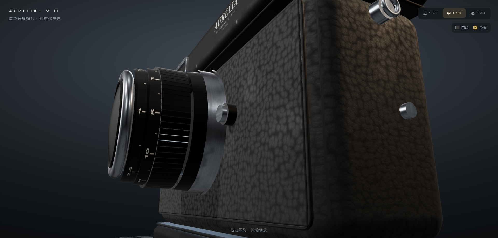

# aaa-3d-object-craft

面向轻量（Flash）LLM 的 Three.js 单体创作技能，目标是稳定产出接近 AAA 游戏画质的单件资产（角色、道具、器械、载具、器物），旨在用低成本创作高质量的 3D 游戏资产。技术栈为 Three.js + 程序化 PBR：表面与材质由代码生成，不依赖外部贴图，最终产出可直接打开的单文件 HTML。

A Three.js skill for lightweight (Flash) LLMs, built to produce near-AAA single assets (characters, props, devices, vehicles, artifacts), aiming to create high-quality 3D game assets at low cost. It uses Three.js with procedural PBR: surfaces and materials are generated in code with no external textures, and each result is a self-contained HTML file that opens directly.

## 示例 / Examples

示例按以下顺序展示：相机（皮质、金属材质、刻字）、鹈鹕骑单车(老演员来撑个场)、银行家台灯(玻璃、黄铜、大理石)、法师（织物、木材、人物形态，PS:脸部、手型强差人意）。

The examples below are shown in this order: camera (leather, metal, engraving), pelican riding a bicycle (an old actor making a cameo), banker lamp (glass, brass, marble), mage (fabric, wood, character form; PS: the face and hands leave much to be desired).

**相机 / Camera**

**鹈鹕骑单车 / Pelican on a Bicycle**

https://github.com/user-attachments/assets/96dc5c07-62dd-419a-9335-5427624c27b6

[▶ pelican.mp4](images/pelican.mp4)

**银行家台灯 / Banker Lamp**

https://github.com/user-attachments/assets/3e08dbc7-d771-4531-8c43-9af007a2ed11

[▶ banker-lamp.mp4](images/banker-lamp.mp4)

**法师 / Mage**

[▶ mage.mp4](images/mage.mp4)

## 重要说明 / Important Note

受 Flash 级 LLM 构造能力限制，复杂形态与空间结构未必一次到位，可能需要多轮人工反馈调整才能达到满意效果。本仓库示例均由 deepseek-flash 一次生成，未做人工修模。

Due to the construction limits of Flash-tier LLMs, complex forms and spatial structures may not be perfect in one pass and may require several rounds of human feedback. All examples in this repository were generated in a single run by deepseek-flash, with no manual mesh fixes.

## 使用 / Usage

将本目录放入 `/skills/`，或按所用 Agent Skills 客户端的方式加载；调用后产出一个可直接打开的单文件 HTML。适用于 Codex、Claude Code、desskharness 等 harness 或 agent 使用。

Place this directory under `/skills/`, or load it with your Agent Skills client; the skill outputs a directly openable single-file HTML. It works with harnesses and agents such as Codex, Claude Code, and desskharness.

## TODO

1）人物脸型、手型特调优化；2）动物形态优化；3）皮毛、鳞片等特殊表面处理。

(1) Character face and hand tuning; (2) animal form optimization; (3) fur, scales, and other special surface treatments.
